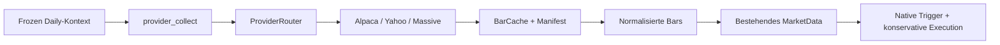

# Historische Intraday-Provider

Der Layer erfasst historische US-Aktienbars getrennt von Strategien und
Ausführung. Strategiequellen, Parameter, SETUP_READY-Regeln, PIT_SAFE,
Open-T+1-Execution und Portfolio-/Monte-Carlo-Infrastruktur bleiben erhalten.
Die bestehende Yahoo-Akquisition in `true_trade_collect.py` und
`intraday_audit.py` bleibt unverändert verfügbar.

## Vertrag und Architektur

`intraday_providers.IntradayProvider` definiert `supported_timeframes()`,
`capabilities()`, `coverage(request)`, `preflight(request)`,
`fetch_page(request, cursor)` und `fetch_bars(request)`. Die Basisklasse
übernimmt Pagination, Cache/Checkpointing, Fehlerstatus und Validierung.
Neue Adapter implementieren Auth-Präsenz und Seitenabruf; registriert werden
sie im Router. Strategie-Logik muss dafür nicht geändert werden.



`BarRequest(ticker, timeframe, start, end, adjustment)` verwendet präzise,
zeitzonenbehaftete Zeitgrenzen und intern `[start, end)`. Ticker und UTC werden
kanonisiert. Timeframes sind `1m`, `5m`, `15m`, `60m`; die Aliase `1Min`,
`5Min`, `15Min`, `60Min`, `1Hour` werden akzeptiert. Intraday-Starts müssen
auf einer vollen Minute liegen. Adjustments sind `raw` oder `split`, niemals
stillschweigend dividendenadjustiert.

| Normalisiertes Feld | Bedeutung |
|---|---|
| `ticker` | Angefragtes US-Aktiensymbol |
| `timestamp_utc` | Bar-Start in UTC, ISO 8601 mit Z |
| `timestamp_new_york` | Derselbe Instant mit New-York-UTC-Offset |
| `timezone` | `America/New_York` |
| `open`, `high`, `low`, `close`, `volume` | Unveränderte Provider-OHLCV |
| `vwap`, `trade_count` | Optional, sonst `null` |
| `provider`, `feed` | Identität bleibt an jeder Bar erhalten |
| `adjustment` | `raw` / `split` des ursprünglichen Abrufs |
| `session` | `PREMARKET`, `REGULAR`, `AFTERHOURS`, `CLOSED` |
| `session_calendar_status` | Verifizierter Kalender oder `CLOCK_ONLY_UNVERIFIED` |
| `timeframe` | Kanonische Bar-Größe |

Das bestehende `Clock`-Modell normalisiert US-DST seit 2007 unabhängig von der
Host-Zeitzone. Für 2024-2027 enthält das Repository einen expliziten
Exchange-Kalender mit Feiertagen und frühen Schlüssen. Bei älteren
Capability-Probes werden Uhrzeitfenster ausdrücklich als
`CLOCK_ONLY_UNVERIFIED` markiert. Ältere Strategie-Replays benötigen einen
passenden gelieferten Kalender; es wird kein damaliger Börsenkalender erfunden.

## Adapter

### Yahoo

`YahooProvider` delegiert an das bestehende `request_chart`; keine
Endpoint-Rotation, kein Umgehen abgelehnter Historienfenster. Konservative
Grenzen des neuen Adapters: 1m sieben Kalendertage, 5m/15m 60 Tage, 60m
730 Tage. Der Server kann strengere Grenzen setzen. Diese Schutzgrenzen sind
keine Zusage tatsächlich gelieferter Historie.

Yahoo liefert den bestehenden split-adjustierten Quote-Basisstand,
`provider=YAHOO`, `feed=UNSPECIFIED`, `INTRADAY_HISTORY_LIMITED`.
Raw wird nicht vorgetäuscht. Keine Auth erforderlich. Die bestehende
Stop-Regel bei 429/401/403 bleibt bestehen, ohne automatische Wiederholung.
Ein archivierter Yahoo-Fehler bleibt unveränderlich; ein bewusst neuer
Netztest braucht ein neues Cache-Verzeichnis.

### Alpaca

Nur `https://data.alpaca.markets/v2/stocks/{symbol}/bars` wird aufgerufen.
Auth kommt ausschließlich aus `ALPACA_API_KEY` und `ALPACA_API_SECRET`, über
`APCA-API-KEY-ID` / `APCA-API-SECRET-KEY`. Ohne beide Werte wird keine Anfrage
gesendet. Es gibt weder Broker-Verbindung noch Trading-API-Abhängigkeit.

Feed ist konfigurierbar: `iex` (Default) oder `sip`. Ausgabe ist immer
`provider=ALPACA`, `feed=IEX` oder `SIP`. IEX ist ein einzelner Handelsplatz;
Volumen, Bars, Lücken und damit Rekonstruierbarkeit sind nicht mit SIP
gleichzusetzen. SIP wird nie als kostenlos berechtigt vorausgesetzt.

REST-Werte: `1Min`, `5Min`, `15Min`, für 60 Minuten `1Hour`. Die aktuelle
offizielle REST-Spezifikation begrenzt Minutenmultiplikatoren auf 1-59;
deshalb wird der unterstützte interne `60m`/`60Min`-Wunsch als `1Hour`
übertragen. Vollständige Pagination folgt `next_page_token`, auch nach einer
leeren Zwischenseite. `raw` und `split` werden explizit gesendet.

### Massive

Nur Market-Data-HTTPS auf `api.massive.com`, Auth ausschließlich aus
`MASSIVE_API_KEY` als Bearer-Header. Ohne Key: `DATA_UNAVAILABLE`, null
Netzwerkaufrufe, auch bei Reference-Methoden.

Aggregate:
`/v2/aggs/ticker/{ticker}/range/{1|5|15|60}/minute/{from_ms}/{to_ms}`.
`adjusted=false/true` wird explizit gesetzt und gegen eine vorhandene
Antwortkennzeichnung geprüft. UTC-Epoch-Millisekunden werden normalisiert.
Premarket/Regular/Afterhours bleiben erhalten; `next_url` wird vollständig
verfolgt. Weiterleitungen auf andere Hosts werden abgewiesen; API-Keys in
Continuation-URLs werden entfernt und nicht gespeichert.

Vorbereitete, separat aufzurufende Reference-Methoden:

- `tickers(active=True/False, as_of=...)`: `/v3/reference/tickers`.
- `ticker_details(ticker, as_of)`: `/v3/reference/tickers/{ticker}` mit `date`.
- `splits(ticker)`: aktueller `/stocks/v1/splits`, mit Pagination.
- `ticker_events(ticker)`: experimenteller `/vX/reference/tickers/{ticker}/events`.

Diese Antworten ändern keine Strategie und werden nicht automatisch geladen.
Sie sind spätere Bausteine für Delisting-/Identitätsprüfungen, keine aktuelle
PIT- oder Survivorship-Zertifizierung. Der Capability-Audit lädt bei vorhandenem
Key nur ein zehnminütiges AAPL-Fenster; keinen breiten Reference-Datensatz.

## Auswahl und Provenienz

`intraday-provider-config.json` enthält ausschließlich Datenprovider-Konfiguration:

```json
{
  "priority": ["ALPACA", "YAHOO", "MASSIVE"],
  "alpaca_feed": "iex",
  "adjustments": {"ALPACA": "raw", "YAHOO": "split", "MASSIVE": "raw"}
}
```

Für spätere Massive-Priorität reicht `priority=["MASSIVE","ALPACA","YAHOO"]`.
Die Strategieparameter liegen weiterhin unverändert in `true-trade-config.json`.

Der Router behandelt alle angefragten Frames einer Aktie/Session als Bundle.
Er wählt einen Provider anhand erfolgreicher Requests und einer vorhandenen
Opening-Beobachtung. Jeder Frame wird geprüft: `INTRADAY_HISTORY_LIMITED` bei
1m verhindert keinen zulässigen 5m-Abruf desselben Providers. Fehlende oder
fehlerhafte andere Frames verwerfen ein bereits gültiges Opening nicht.
`selection_basis` dokumentiert Regel, Opening und den nativen Frame. Es bleibt
bei 1m, wenn dessen Opening vorhanden ist, sonst 5m. Spätere Fehler, Trigger
oder Exit-Ergebnisse lösen keinen Providerwechsel aus.

Numerische Fehler erzeugen explizite Lücken. Ein Strukturfehler wie ein
Duplikat stoppt die Zulassung an dieser Beobachtung in Antwortreihenfolge;
diese Beobachtung und ihr Suffix werden quarantänisiert. Der zuvor gültige
Anfang bleibt unverändert. Kein nachträgliches Sortieren, Überschreiben einer
früheren Beobachtung oder Auffüllen. `validation_cutoff`, `quarantined_bars`
und der weiterhin ungültige Qualitätsstatus dokumentieren den Fehler.
Antwortreihenfolge ersetzt keinen historischen Delivery-/Vintage-Nachweis.

Ein späterer Pagination-Fehler kann `AVAILABLE_PREFIX` mit getrenntem
`download_status` und `download_complete=false` liefern, wenn die bereits
geladenen Beobachtungen validiert sind und Download-Voraussetzungen vorliegen.
Der Collector pinnt den Provider im Fortschrittsmanifest auch für Resume;
ein späterer Auth-Fehler darf nicht still auf Yahoo umschalten. Ein solcher
Chunk bleibt unvollständig und kann später auf demselben Provider fortsetzen.

Die Trigger-Rekonstruktion prüft die Provenienz des bis dahin beobachteten
Präfixes. Execution prüft danach jede benötigte Bar bis zum tatsächlichen Exit
gegen Provider, Feed und Adjustment des Triggers. Wechsel ergeben
`MIXED_PROVIDER_DATA` und keinen primären True Trade. Ein späterer Wechsel
nach dem Exit verwirft einen früheren Trade nicht rückwirkend. Alte Datensätze
ohne Quellenfelder bleiben als `LEGACY_UNSPECIFIED` lesbar; bei der neuen
Akquisition sind diese Felder zwingend vorhanden.

`provider_collect` übernimmt Daily-Bars, Universum, Splits und Evidence aus
einem eingefrorenen bestehenden Datensatz. `basis.py` verlangt einen expliziten
Nachweis der Daily-Basis in `provenance.daily_price_basis[TICKER]`:

```json
{
  "adjustment": "split",
  "anchor_date": "2026-11-10",
  "complete_from": "2024-01-01",
  "complete_through": "2026-11-10",
  "bars_sha256": "SHA256 via common.digest(daily_rows)",
  "splits_sha256": "SHA256 via common.digest(frozen_symbol_splits)",
  "evidence_id": "Referenz auf den archivierten Snapshot und seine Actions"
}
```

`anchor_date` bezeichnet die tatsächliche Split-Basis, nicht bloß den letzten
Handelstag oder Abrufzeitpunkt. Der als vollständig dokumentierte Ledger muss
von spätestens der Intraday-Session bis zum Anker reichen. Hashes binden
exakt die gespeicherten Daily-Bars und ihren Split-Ledger; ein leeres Ledger
oder ein heutiger Downloadzeitpunkt allein ist kein Kompatibilitätsnachweis.
Der Nachweis muss aus archivierten Quellinformationen stammen. Seine
Vollständigkeit wird nicht durch eine selbst eingetragene Kennung bewiesen.

Bei split-adjustiertem Intraday-Input ist ein entsprechender Quellnachweis
erforderlich: `fetched.basis_evidence` oder
`source_basis_evidence[common.digest(fetched.request)]` in der eingefrorenen
Provider-Konfiguration. Er hat dieselben Felder und zusätzlich `splits` mit
dem zugehörigen Quell-Ledger. `bars_sha256` bindet die tatsächlich verwendeten
normalisierten Quellbars einschließlich Provider, Feed, Frame und Adjustment.
Die deklarierte Split-Adjustierung umfasst Preise und inverses Aktienvolumen.
Überlappende vollständige Ledger müssen übereinstimmen.

Mit `F_source` und `F_daily` als kumulativen Split-Faktoren nach der Session
bis zum jeweiligen Anker wird gerechnet:

```text
storage OHLC/VWAP = source OHLC/VWAP * F_source / F_daily
storage volume   = source volume   * F_daily / F_source
```

Bei Raw ist `F_source=1`. Ein 2:1-Split nach dem Daily-Snapshot kann damit
eine später adjustierte historische Intraday-Quote 50 auf die eingefrorene
Basis 100 zurückführen; auch die umgekehrte Richtung ist geprüft. Für Raw
wird kein zusätzlicher heutiger Split in den eingefrorenen Ledger erfunden.
Das bestehende `session_rows` stellt daraus unverändert die Entscheidungsbasis
wieder her.

Quell-`adjustment` bleibt erhalten; `source_adjustment`, `source_basis_id`,
`storage_adjustment`, `storage_basis`, `storage_basis_id`, `basis_status` und
`basis_price_factor` dokumentieren Quelle und tatsächliche Speicherbasis
getrennt. Nur `VERIFIED` wird übernommen. Fehlende Nachweise ergeben
`BASIS_COMPATIBILITY_UNKNOWN`, falsche Hash-Bindung
`BASIS_EVIDENCE_MISMATCH`, widersprüchliche Ledger `BASIS_INCOMPATIBLE`.
Ist der unverändert gewählte Opening-Frame betroffen, wird die Session
explizit ausgeschlossen; es gibt keinen nachträglichen Provider-/Framewechsel.

Replay und Execution blockieren außerdem bereits als neue Speicherbasis
markierte Alt-Artefakte ohne Verifikation. Legacy-Datensätze ohne solche
Felder bleiben unter ihrem bisherigen, nicht PIT-zertifizierten Vertrag
lesbar. Alte Collector-Chunks ohne Basisnachweis werden nicht als verifiziert
resumiert: `basis_policy_version=1` verlangt dafür einen neuen Run-Pfad.

`available_at` ist weiterhin frühestens Bar-Ende, ausdrücklich als
retrospektive Annahme markiert. Der Layer beseitigt keine Vendor-Revisionen
oder fehlende historische Vintages. `NOT_HISTORICALLY_PIT_CERTIFIED` bleibt
bestehen. Intraday-Lücken bei IEX können das bestehende konservative
Opening-Präfix früher beenden; die Execution-Regeln werden dafür nicht gelockert.

## Cache, Limits und Datenqualität

Lokaler Cache-Key: Provider, Feed, Ticker, Timeframe, Start, End, Adjustment
und Schema-Version. Cache-Root ist standardmäßig
`trader-backtest/intraday-cache/`; Run-Artefakte liegen unter dem ebenfalls
ignorierten `trader-backtest/runs/`. `.env` und Python-Caches sind ignoriert.
Keine Secrets gehören in Konfiguration, Reports, URLs oder Git.

Pro Request speichert ein atomisches Manifest Seitenprüfsummen, Cursor,
Fortschritt, Abschlussstatus, HTTP-Status-Metadaten und Fehlerhistorie.
Ein unterbrochener Abruf setzt am nächsten Cursor fort. Eine bereits
gespeicherte letzte Seite wird ohne erneuten Download finalisiert, sofern die
Download-Voraussetzungen für diesen noch unvollständigen Checkpoint gelten.
Nur explizit vollständige Einträge werden vor Netzwerk-Preflight gelesen und
integritätsgeprüft; sie bleiben auch nach Ablauf der Yahoo-Historiengrenze,
ohne Auth oder bei einem im Prozess angehaltenen Provider reproduzierbar.
Cache-Hits führen keine HTTP-Anfrage aus. Unvollständige Einträge umgehen
weder Auth noch Retention/Retry-After. Hash-, Seitenzahl- oder Abschluss-
Inkonsistenzen brechen klar ab.
Ein Writer pro Request-Key wird vorausgesetzt.

Das übergeordnete `progress.json` führt abgeschlossene Aktie/Sessions mit
Chunk-Prüfsummen und eine Fehlerliste. Erneuter Aufruf mit identischen
eingefrorenen Inputs lädt nur fehlgeschlagene oder fehlende Chunks nach.
Historische Fehler bleiben zur Diagnose erhalten. Konfigurations-/Kontextwechsel
erfordern ein neues Run-Verzeichnis.

Alpaca/Massive: höchstens drei Retries, exponentiell 1/2/4 Sekunden,
mit konfigurierbarem lokalen Request-Abstand und maximal 30 Sekunden Backoff.
429 respektiert `Retry-After`, einschließlich HTTP-Datum. Längere Wartefristen
werden im Checkpoint als `retry_not_before` gespeichert; Resume darf nicht
vorher erneut senden. Nach erschöpften 429-Retries oder 401/403 pausiert der
Provider für den laufenden Akquisitionsprozess. 401/403 wird nicht wiederholt;
5xx/Netzwerkfehler haben begrenzte Retries. Es werden keine Fehlertexte oder
Auth-Header gespeichert. Redirects werden nicht verfolgt.

Lokale Defaults: Alpaca 180, Yahoo 120, Massive fünf Requests/Minute.
Das sind konservative Client-Einstellungen, keine behaupteten Account-Limits.
Der tatsächliche Tarif und serverseitige Limits sind ohne Zugang unbekannt.

Validierung meldet Sortierung, doppelte Timestamps, OHLC-/Volumenfehler,
Zeitzonenfehler, fehlende Slots/Session-Ränder und extreme Sprünge. Keine
Interpolation. Lücken können fehlende qualifizierende Trades oder Halts statt
Downloadfehler bedeuten. Gap-/Jump-Diagnosen sind keine nachträglichen
PIT-Selektionsfilter. Die bisherigen kausalen Strategie-QC-Regeln entscheiden
weiterhin anhand des jeweiligen Präfixes.
Numerisch ungültige einzelne Bars bleiben im Cache/Audit nachweisbar und
werden als `quarantined_bars` zu expliziten Lücken im nutzbaren Bar-Strom.
Ein späterer Preisfehler darf keinen Providerwechsel für einen früheren
Trigger auslösen. Strukturfehler wie doppelte Zeitstempel, falsche Identität
oder Zeitzone sperren die betroffene Beobachtung und ihren Suffix, ohne den
bereits gültigen Anfang rückwirkend zu verwerfen. Verfügbarkeit und
Qualitätsstatus sind getrennte Felder; `AVAILABLE` allein bedeutet keine
fehlerfreie vollständige Session.

## Audit und begrenzter Pilot

Aus Repository-Root:

```bash
# Mit fehlenden Keys sind Alpaca/Massive automatisch offline.
# Mit Alpaca-Keys beginnt dieser Audit ausschließlich mit dem kostenlosen IEX-Test.
python trader-backtest/provider_audit.py \
  --output trader-backtest/runs/provider-audit --live-yahoo

# Neue Akquisition auf unverändertem, bereits eingefrorenem Daily-Kontext.
python trader-backtest/provider_collect.py \
  --context trader-backtest/runs/true-trades-first/dataset.json \
  --providers trader-backtest/intraday-provider-config.json \
  --start 2026-08-20 --end 2026-11-12 \
  --output trader-backtest/runs/provider-collection

# Nur nach PASSED beim IEX-Live-Test und vorhandenen Alpaca-Secrets.
python trader-backtest/provider_pilot.py \
  --dataset trader-backtest/runs/true-trades-first/dataset.json \
  --audit trader-backtest/runs/provider-audit/provider-capability-audit.json \
  --start 2026-08-20 --end 2026-11-12 \
  --output trader-backtest/runs/provider-pilot

python -m unittest discover -s tests -q
```

Der Audit meldet Verfügbarkeit (`null` heißt ungetestet), Auth-Präsenz, Feed,
Timeframes, beobachtete früheste/späteste Bar je Frame, Session-Unterstützung
und -Beobachtung, Split-Fähigkeit, Client-Limits und Qualitätsstatus. Die
beobachteten Grenzen sind niemals eine erfundene vollständige Historientiefe.

Bei Alpaca-Auth: AAPL/MSFT/NVDA, 1m/5m, letzter abgeschlossener US-Handelstag
und ein älterer Tag, jeweils kleine Fenster; zusätzliche Pre-/Afterhours-
Probes und erzwungene Zwei-Bar-Pagination. Danach kleine AAPL-Fenster für
2026/2025/2024/2022/2020/2018/2016 sowie TWTR/FB. Eine separate kleine
SIP-Entitlement-Probe hält IEX/SIP auseinander; nur bei Erfolg werden auch
SIP-Historienfenster geprüft. Auth-/Rate-Limit-Fehler stoppen die jeweilige
Testserie. Jahre mit leeren oder fehlgeschlagenen Antworten gelten nicht als
bestätigt abrufbar.

Der Pilot ist Alpaca-only, ohne Fallback im Alpaca-Vergleichsarm. Er verwendet
den ursprünglichen eingefrorenen Yahoo-Datensatz, identische Daily-Bars,
Evidence, Splits, Kalender und Parameter. Der Yahoo-Replay friert die genaue
SETUP_READY-ID-Kohorte ein; beide Arme berichten für dieselben IDs
SETUP_READY, vorhandene Intraday-Präfixe, Trigger, True Trades und Ausschlüsse.
Alpaca-native zusätzliche Setups außerhalb der Kohorte werden separat gezählt.
Abweichende native Validierung bleibt ein Ausschluss, niemals ein erzwungener
Entry. Keine Profitabilitätsanalyse und kein Monte Carlo in diesem Pilot.

## Domains, Secrets und offizielle Verträge

| Zweck | Domain | Secret |
|---|---|---|
| Yahoo-Intraday | `query2.finance.yahoo.com` | keines |
| Weitere bestehende Yahoo-Zugriffe | `query1.finance.yahoo.com` | keines |
| Alpaca Market Data | `data.alpaca.markets` | `ALPACA_API_KEY`, `ALPACA_API_SECRET` |
| Massive Aggregate + Reference | `api.massive.com` | `MASSIVE_API_KEY` |

Alpaca/Massive-Domains müssen in der Cloud-Netzwerk-Allowlist stehen;
Secret-Werte ausschließlich in den Umgebungs-Einstellungen hinterlegen.
Keine Broker-Domain und keine Order-Berechtigung erforderlich.

Geprüfte offizielle API-Verträge:

- [Alpaca Historical Bars, single symbol](https://docs.alpaca.markets/us/reference/stockbarsingle-1)
- [Massive REST-Auth](https://massive.com/docs/rest/quickstart)
- [Massive Aggregate Bars](https://massive.com/docs/rest/stocks/aggregates/custom-bars)
- [Massive Splits](https://massive.com/docs/rest/stocks/corporate-actions/splits)
- [Massive Ticker Events](https://massive.com/docs/rest/stocks/corporate-actions/ticker-events)

Aktueller Implementierungs- und Testbefund:
[INTRADAY-PROVIDERS-REPORT.md](INTRADAY-PROVIDERS-REPORT.md).
